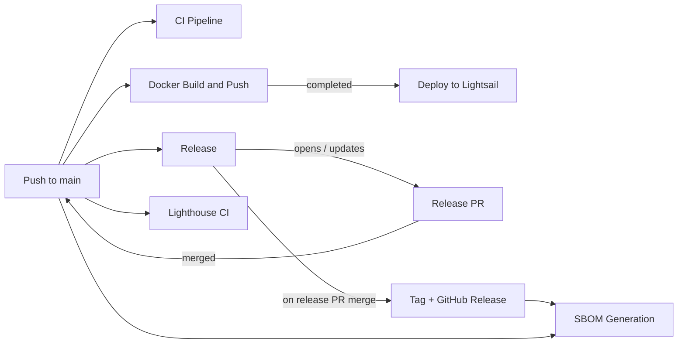

# GitHub Actions Workflow Chain

How the workflows on `main` relate to each other. All jobs run on the
self-hosted runners (`[self-hosted, Linux, X64]`).

| Workflow | File | Trigger |
|---|---|---|
| CI Pipeline | `ci.yml` | Push and PRs to `main`/`develop` |
| Docker Build and Push | `docker-build.yml` | Push to `main` (code changes only) |
| Deploy to Lightsail | `deploy.yml` | Docker Build and Push completed on `main`; manual |
| Release | `release.yml` | Push to `main`; manual |
| SBOM Generation | `sbom.yml` | Push to `main`, `v*` tags, published releases; manual |
| Lighthouse CI | `lighthouse.yml` | Push and PRs to `main`; manual |

## CI Pipeline (`ci.yml`)

Tests & Coverage (unit, E2E and visual tests against a per-run Postgres/Redis
stack), Code Quality, Mutation Testing, License Compliance, dependency and
container scanning, secret scanning and performance tests. Jobs skip on
`chore(release):` commits on `main`; the release PR itself runs the full suite
before it can merge.

## Release (`release.yml`)

release-please keeps one `chore(release): x.y.z` PR open with the version bump
and changelog. Merging it creates the `vX.Y.Z` tag and GitHub Release. Nothing
is pushed to `main` by a bot, so the main ruleset (PR + code-owner review +
required checks) applies to releases too. A second job fails if the newest tag
is not on `main` or does not match `package.json`.

Setup and troubleshooting: [VERSION_WORKFLOW_SETUP.md](VERSION_WORKFLOW_SETUP.md).

## Deploy (`deploy.yml`)

Runs after Docker Build and Push finishes on `main` and rolls the new image out
to Lightsail. Run it manually with an `image_tag` (for example
`sha-<full-sha>`) to roll back.

## SBOM Generation (`sbom.yml`)

Generates CycloneDX (JSON/XML) and SPDX SBOMs, builds and pushes the image with
SBOM and provenance attestations, and scans the SBOM with Trivy. On a published
release it attaches the SBOM files to the release.
